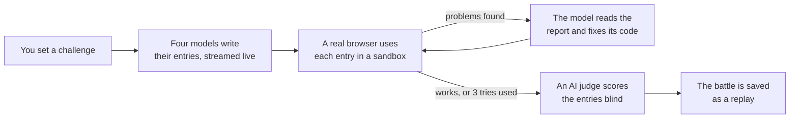

# Code Gladiators

Four AI models from four labs get the same challenge, such as *"Breakout where the bricks fight back"*, and each builds it as a single web page, live, side by side. Every entry runs in a locked-down sandbox, gets used by a real browser, and gets a chance to fix its own bugs. Then an AI judge from a fifth lab scores them, blind. Every battle is saved, so anyone can watch the replay.

It also includes a small benchmark: twelve fixed challenges, each run three times, with a leaderboard worked out from the saved battles.

Everything runs on Vercel's free Hobby plan.

## Contents

- [How a battle works](#how-a-battle-works)
- [What it's built with](#what-its-built-with)
- [Getting started](#getting-started)
- [Using the arena](#using-the-arena)
- [Deploying](#deploying)
- [Configuration](#configuration)
- [Project structure](#project-structure)
- [Development](#development)
- [Costs and limits](#costs-and-limits)
- [Troubleshooting](#troubleshooting)
- [Known limitations](#known-limitations)
- [Licence](#licence)

## How a battle works



1. **Write.** Each gladiator streams a complete HTML page. You watch the code appear.
2. **Test.** The entry is served from a [Vercel Sandbox](https://vercel.com/docs/sandbox) with the internet switched off. A headless browser loads it, presses Start, holds and taps keys, moves the mouse, and collects any errors. It also checks that a game reacts to its controls and that its canvas isn't empty.
3. **AI test.** If that passes, a small vision model uses the entry with a goal, for example doing a sum on a calculator, and reports anything that doesn't work.
4. **Fix.** If anything failed, the gladiator gets the full report and rewrites its page. It has three attempts in total.
5. **Judge.** A judge from a lab that isn't competing scores creativity, polish and fidelity to the challenge, out of 10 each. It reads the code and the test results, and sees a screenshot of each entry. Entries are labelled "Entry A" to "Entry D" in a random order, so the judge can't favour a name or a position.
6. **Save.** Every event is saved to [Vercel Blob](https://vercel.com/docs/vercel-blob) as a replay.

A battle runs as a [Vercel Workflow](https://vercel.com/docs/workflows): each step runs in its own function call, so a battle can run for many minutes, survive a crash, and be picked up again if you refresh the page.

## What it's built with

| Job | Tool |
| --- | --- |
| Call models from many labs with one key | [Vercel AI Gateway](https://vercel.com/docs/ai-gateway) |
| Stream text, structured output and images | [AI SDK](https://ai-sdk.dev) |
| Run untrusted, AI-written code | [Vercel Sandbox](https://vercel.com/docs/sandbox) |
| Drive a headless browser | [agent-browser](https://github.com/vercel-labs/agent-browser) |
| Long-running, resumable battles | [Vercel Workflow](https://vercel.com/docs/workflows) |
| Store replays | [Vercel Blob](https://vercel.com/docs/vercel-blob) |
| Keep bots from starting battles | [Vercel BotID](https://vercel.com/docs/botid) |
| The app | [Next.js](https://nextjs.org) 16 with Tailwind CSS |

## Getting started

### What you need

- **Node.js 20.9 or later** (22 recommended) and npm.
- **A Vercel account.** The free Hobby plan is enough.
- **The Vercel CLI:** `npm install --global vercel`, then `vercel login`.
- **AI Gateway credit.** Hobby accounts get US$5 of free AI Gateway credit a month. It only switches on once a card is added to the account, although the Hobby plan doesn't charge it. A battle typically costs a penny or two.

### 1. Install

```bash
git clone https://github.com/steve-dickinson/code-gladiators.git
cd code-gladiators
npm install
```

### 2. Create and link a Vercel project

```bash
vercel link
```

Choose **Create a new project** when asked. AI Gateway, Sandbox and Workflow need no further setup: the project's login token covers them.

### 3. Add a Blob store

In the [Vercel dashboard](https://vercel.com/dashboard), open the project, go to **Storage**, create a **Blob** store and connect it to the project. This is where replays are saved.

### 4. Download the project's environment variables

```bash
vercel env pull .env.local
```

This writes `VERCEL_OIDC_TOKEN` and the Blob variables to `.env.local`. The token lasts 12 hours when you run locally; run this command again when it expires (see [Troubleshooting](#troubleshooting)).

### 5. Choose an arena key

Only someone with the arena key can start a live battle, because battles spend your AI credit. Everyone else can watch replays. Add a long random key to `.env.local`:

```bash
# macOS / Linux
echo "ARENA_KEY=$(openssl rand -hex 16)" >> .env.local
```

```powershell
# Windows PowerShell
Add-Content .env.local "ARENA_KEY=$([guid]::NewGuid().ToString('N'))"
```

`.env.example` lists every variable the app reads.

### 6. Check your models

```bash
npm run check-models
```

This sends a tiny request to each configured model and prints whether your account can call it, and what it costs. If one fails, see [Configuration](#configuration) to swap it.

### 7. Run it

```bash
npm run dev
```

Open http://localhost:3000, type a challenge, enter your arena key, and press **Release the gladiators**.

## Using the arena

- **Live battles** (`/`). Type any challenge, or pick one of the suggestions. The page follows the battle as it runs and picks it up again if you refresh.
- **Replays** (`/replays`). Every saved battle, played back with its original timing. Replays cost nothing to watch.
- **Leaderboard** (`/leaderboard`). Per-model statistics from every saved battle: wins, average scores, how often the code worked first time, and cost.
- **Benchmark.** Twelve fixed challenges (games, tools, toys and two creative twists), each run three times, so every model faces the same tasks. Press **Run** on a challenge on the leaderboard, or **Run the next benchmark round** in the arena to run every challenge that still needs a run, one after another, with a minute's pause between battles. Only blind-judged battles with a benchmark challenge's exact wording count.
- **Rematches.** From any judged replay, **Rematch with memory** runs the same challenge again. A random half of the gladiators first read the judge's verdict on their last entry; the other half are a control group. The verdict shows whether the coached half improved more.

## Deploying

1. Add the arena key to the Vercel project (the other variables are already there):

   ```bash
   vercel env add ARENA_KEY
   ```

2. Deploy:

   ```bash
   vercel deploy --prod
   ```

   Or connect the repository to the project in the Vercel dashboard, and every push to `main` deploys.

## Configuration

Everything you're likely to change is in two files.

**`src/lib/gladiators.ts`**

- `GLADIATORS`: the four competing models. Any [AI Gateway](https://vercel.com/docs/ai-gateway) model slug works; run `npm run check-models -- --scan` to list every cheap model your account can call.
- `JUDGE_MODEL`, `QUICK_JUDGE_MODEL`, `VISION_JUDGE_MODEL`: the judges. Keep them from labs that aren't competing.
- `AI_TESTER_MODEL` and `AI_TESTER_FALLBACKS`: the AI tester. It must be able to read images; run `npm run check-models -- --vision` to list the models that can.
- `LIMITS`: rounds per battle, output tokens per entry, time limits.

**`src/lib/benchmark.ts`**

- `BENCHMARK`: the challenges, `BENCHMARK_RUNS`: runs per challenge.
- `BENCHMARK_FROM`: battles before this date don't count. Move it forward, and start again, whenever you change the rules (models, judges or testing), so every run is comparable.
- `BENCHMARK_VOID`: individual battles to leave out, with the reason.

## Project structure

```
src/
├── app/
│   ├── page.tsx                      The arena
│   ├── replays/                      Replay gallery and player pages
│   ├── leaderboard/page.tsx          Leaderboard and benchmark
│   └── api/
│       ├── battle/route.ts           POST: start a battle (or a rematch)
│       ├── battle/[runId]/stream/    GET: a battle's events, as NDJSON
│       └── benchmark/route.ts        GET: runs per benchmark challenge
├── workflows/
│   ├── battle.ts                     The battle, as a durable workflow
│   └── steps.ts                      Its steps: write, test, judge, save
├── lib/
│   ├── gladiators.ts                 Models and limits
│   ├── prompt.ts                     Prompts, and pulling HTML out of replies
│   ├── arena.ts                      The battle's sandbox
│   ├── browser.ts                    A headless browser session
│   ├── browser-test.ts               The scripted browser test
│   ├── page-scripts.ts               JavaScript run inside the entry's page
│   ├── ai-tester.ts                  The AI tester
│   ├── judge.ts                      Blind judging
│   ├── replays.ts                    Saving and loading replays
│   ├── leaderboard.ts                Statistics from replays
│   ├── benchmark.ts                  The benchmark challenges
│   ├── rematch.ts                    Planning rematches
│   ├── battle-state.ts               The reducer behind live battles and replays
│   └── types.ts                      Shared types, including every battle event
└── components/                       The UI
scripts/check-models.mts              Which models your account can call
```

A battle's events are the one data format that ties it together: the workflow streams them to the page, the page reduces them into what's on screen (`battle-state.ts`), and the same events are saved as the replay. Their types are in `src/lib/types.ts`.

## Development

```bash
npm run dev          # the app, at http://localhost:3000
npm test             # unit tests (Vitest)
npm run test:watch   # unit tests, re-run on save
npm run lint         # ESLint
npm run typecheck    # TypeScript
npm run check        # lint, typecheck and tests together
npm run build        # a production build
```

Unit tests sit next to the code they test (`src/lib/*.test.ts`) and cover the logic that doesn't need a model or a sandbox: HTML extraction, reading the AI tester's replies, blind labelling, the leaderboard and benchmark rules, rematch planning and the battle reducer. GitHub Actions runs lint, typecheck, tests and a build on every push and pull request (`.github/workflows/ci.yml`).

Locally, workflows run in-process and keep their run data in `.workflow-data/`.

## Costs and limits

All figures are from running this project on the Hobby plan; prices change, so check the linked pages.

- **Model fees.** Most battles cost 1p to 3p across all four gladiators; a fix round costs a little more because the model gets its previous version back. A full 36-battle benchmark cost about 56p (US$0.73). The free AI Gateway credit is US$5 a month.
- **Sandbox.** Hobby includes 5 hours of sandbox CPU time a month ([pricing](https://vercel.com/docs/sandbox/pricing)). A battle uses a 2-vCPU sandbox for a few minutes of real work. If you run out, new sandboxes pause until the next month and nothing is charged; battles still run, untested.
- **Functions.** Every workflow step must finish within 300 seconds, which is why writing, testing and judging each have their own time limits in `LIMITS`.
- **Blob.** Uploads and listings are "advanced operations", with a monthly allowance. Each battle uses about three; viewing replays uses none.
- **Rate limits.** Some free-tier models allow only a few requests a minute. The AI tester and the benchmark runner's pause between battles are set up with this in mind.

## Troubleshooting

| Problem | Fix |
| --- | --- |
| "Unauthenticated request to AI Gateway" | The local login token has expired (it lasts 12 hours). Run `vercel env pull .env.local` and restart `npm run dev`. |
| "The arena is closed" | `ARENA_KEY` is missing from `.env.local` (or the Vercel project), or the key you typed doesn't match. |
| No replays, or an empty leaderboard | The Blob store isn't connected to the project. Connect it, then run `vercel env pull .env.local` again. |
| A test result says "AI didn't run" | Hover over it to see why. It's usually a rate limit: try another model for `AI_TESTER_MODEL`. |
| A model fails in every battle | Run `npm run check-models`. The model may not be available to your account; swap it in `gladiators.ts`. |
| "Module not found" after moving files | Turbopack's cache is stale. Stop the dev server, delete `.next`, and start it again. |
| Battles won't start under `npm start` locally | BotID's check needs Vercel's routing. Use `npm run dev` locally, or a deployment. |

## Known limitations

- **One AI judge.** Scores reflect one model's taste, even judged blind. Treat the leaderboard as the result of one experiment, not a ranking of models.
- **The AI tester is weak.** With small, cheap models it often can't drive a browser reliably, and it rarely finds bugs the scripted test misses. Results lean on the scripted browser test and the judge.
- **Free-tier models only.** The default lineup is chosen from models a Hobby account can call, which leaves out each lab's largest models.

## Licence

[MIT](LICENSE) © 2026 Steve Dickinson
